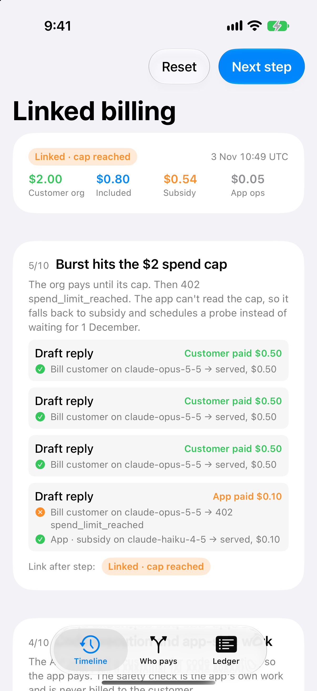
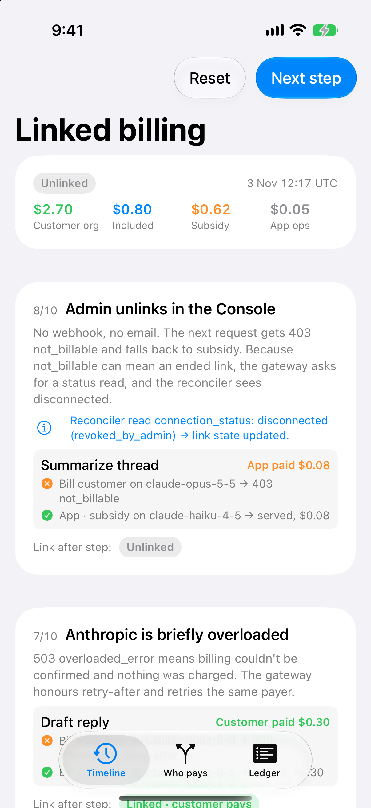
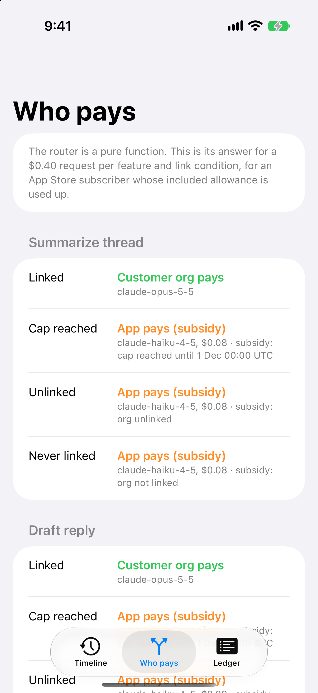
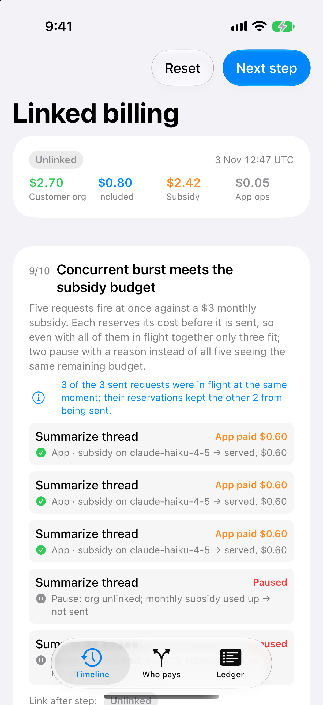
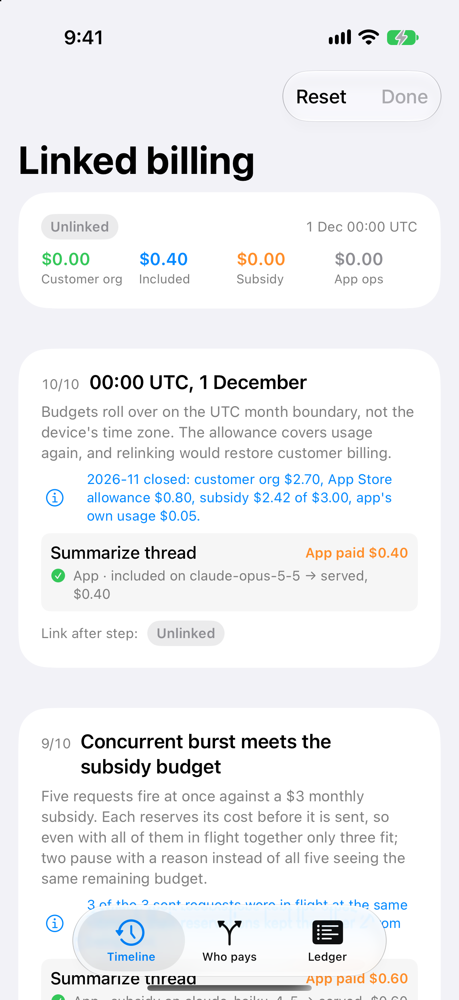
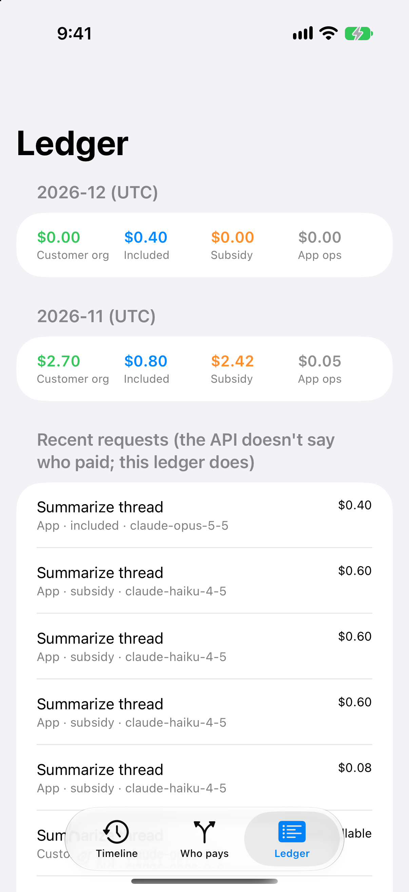

# LinkedBilling Demo

**One B2B customer's month: their Claude org pays for your app's AI, then hits its cap, then unlinks you without telling you. Every request is either served by the right payer or paused with a reason, and the ledger knows who paid for each one.**

This is the runnable companion to [**linked-billing-kit**](https://github.com/rajatslakhina/linked-billing-kit), a Swift package for Anthropic's Linked billing beta (17 Nov 2026). With it, a customer links their Claude organization to your app and pays for the usage they cause (`bill_to: "user_profile"`). The app pulls the package from GitHub as a version-pinned remote dependency, so it builds against exactly what an integrator would get.

  
  
  

*Real screenshots from an iOS 27.2 Simulator (iPhone 17 Pro), taken by the headless run described under [Verification](#verification). Left: the burst that hits the $2 spend cap. Middle: the silent unlink being detected. Right: the router's table.*

## Why this matters

Linked billing changes "who pays for inference" from a fixed fact into a decision made on every request. The API gives you three new refusals and a link that can end with **no webhook and no email**. You also get **no way to read the customer's spend cap**, and **no indication in a successful response of who was billed**. If you get it wrong, a customer sees errors, or you end up silently paying for their usage all month. The demo shows each of those cases happening and being handled. Nothing on screen is canned: each card is what the real `LinkedBillingGateway` did against a simulated Claude API.

## What you'll see

**Timeline**: tap **Next step** to play the month (all times UTC):

| Step | What happens | What the package does |
|---|---|---|
| 1–2 | App Store subscriber, org not linked | Pays from the $1 included allowance, then subsidises on the cheaper model |
| 3 | Admin links their org with a $2 cap | `LinkSession` rejects a forged callback and accepts the real one. The first request hits the ~10 s propagation window and is retried once |
| 4 | Code execution + a safety check | Both app-paid: the API can't bill a customer for code execution, and app-side work is never billed to customers |
| 5 | Burst hits the cap | 3 × customer-billed, then `402 spend_limit_reached` → subsidy fallback **in the same call** |
| 6 | Admin raises the cap (no notification) | 16 min later one **probe** tests the customer again and the link is billable again |
| 7 | `503 overloaded` | Honours `retry-after`, retries the same payer, nothing double-charged |
| 8 | Admin unlinks in the Console | `403 not_billable` → subsidy → status read → **Unlinked** |
| 9 | Five requests fire **concurrently** at the $3 subsidy budget (the simulator holds the replies until every sent request is in flight, or 0.5 s pass, so the overlap is real) | Each reserves its cost before it is sent, so even with all of them in flight together only three fit; two pause with a reason. The card reports how many were in flight at once |
| 10 | 00:00 UTC, 1 December | November closes at customer $2.70 · allowance $0.80 · subsidy $2.42 of $3.00 · app usage $0.05 |

**Who pays**: the router's decision for every feature × link condition. **Ledger**: per-month totals and every request that was sent, including the refused ones. Paused requests are never sent, so they don't appear.

  
  
  

These numbers aren't hand-typed. The screens render `ScriptedMonth` from the library, and the library's `ScriptedMonthTests` runs that same object and asserts these totals.

## How it's wired

| File | What it does |
|---|---|
| [`Demo/DemoApp.swift`](Demo/DemoApp.swift) | Owns the business rules: four features (two subsidisable on `claude-haiku-4-5` at 20% of the cost, one using code execution, one app-operational), a $1/month App Store allowance and a $3/month subsidy budget. Parses the launch arguments. |
| [`Demo/BillingDemoModel.swift`](Demo/BillingDemoModel.swift) | `@MainActor @Observable` view model. It steps the library's `ScriptedMonth` and publishes the link phase, the month's totals and the ledger. |
| [`Demo/DemoViews.swift`](Demo/DemoViews.swift) | The Timeline, Who pays and Ledger screens (SwiftUI). |
| [`Demo/Format.swift`](Demo/Format.swift) | Turns every decision, refusal and pause reason into the words on screen. |

`ScriptedMonth` (from the package's `LinkedBillingTesting` product) drives the real `LinkedBillingGateway`, `ConnectionReconciler` and `LinkSession` against `SimulatedClaudeOrg`, a deterministic stand-in that applies the documented checks in order. In production the gateway runs in your Swift back end with the operator credential. Here everything runs in-process, so the demo needs no account.

## How to run it

1. `git clone https://github.com/rajatslakhina/linked-billing-kit-demo-app.git`
2. Open `Demo.xcodeproj` in Xcode. It was built and run with Xcode 27.2; the project targets Swift 6.0 and iOS 17, and CI builds it with the default Xcode on GitHub's `macos-15` image. Xcode resolves `linked-billing-kit` from GitHub (pinned up to the next major from 2.6.1; `Package.resolved` is committed).
3. Select the **Demo** scheme and any iOS 17+ Simulator, then **Build & Run**.
4. Tap **Next step** to walk through the month, or pass launch arguments: `-steps 5` runs the first five steps, `-autoplay` runs all ten, and `-tab router` / `-tab ledger` opens a tab.

No API key or account is needed.

## Verification

- **Built against the published package.** `xcodebuild -resolvePackageDependencies` resolves `LinkedBilling … @ 2.6.1` from GitHub (`Package.resolved` pins revision 56c4eb8). The app then builds for an iPhone 17 Pro Simulator on iOS 27.2 (Xcode 27.2).
- **Run headlessly on the Simulator.** The app was installed and launched six times with the launch arguments above (`-steps 5`, `-steps 8`, `-steps 9`, `-autoplay`, `-tab router`, `-tab ledger -autoplay`). Each process was still running 7 s after launch, and each screenshot in `Demo/Screenshots` was captured from one of those runs.
- **The numbers are tested, not typed.** The screens render the library's `ScriptedMonth`, and the library's `ScriptedMonthTests` runs that same object and asserts the totals shown here. The library has 149 tests and 88 mutants, run in its CI on macOS and Linux.
- **CI** ([Actions](../../actions)) resolves the package from GitHub using the committed `Package.resolved`, then builds the app for a generic iOS Simulator.

## License

MIT
